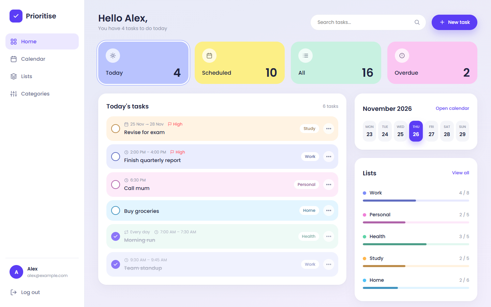
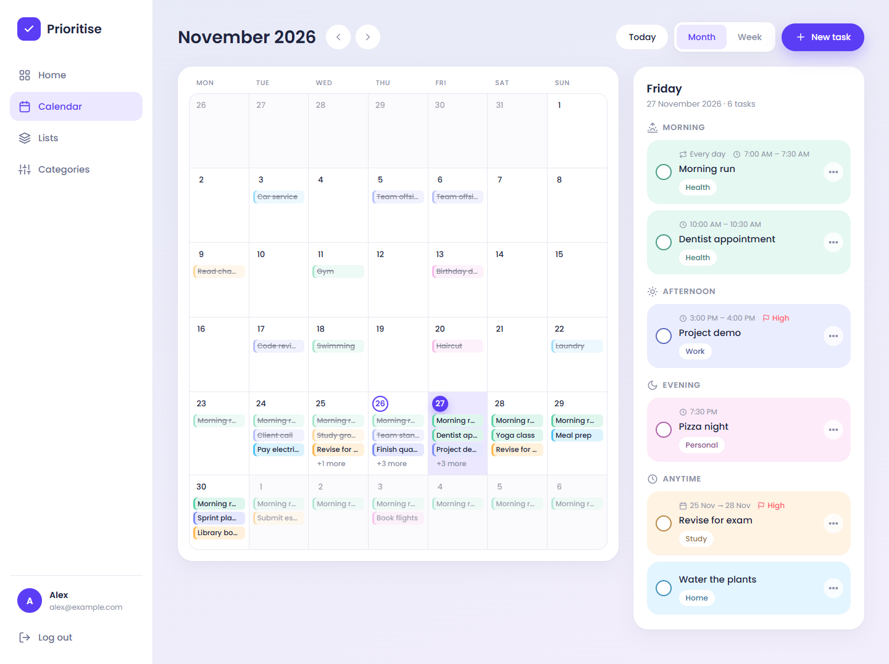
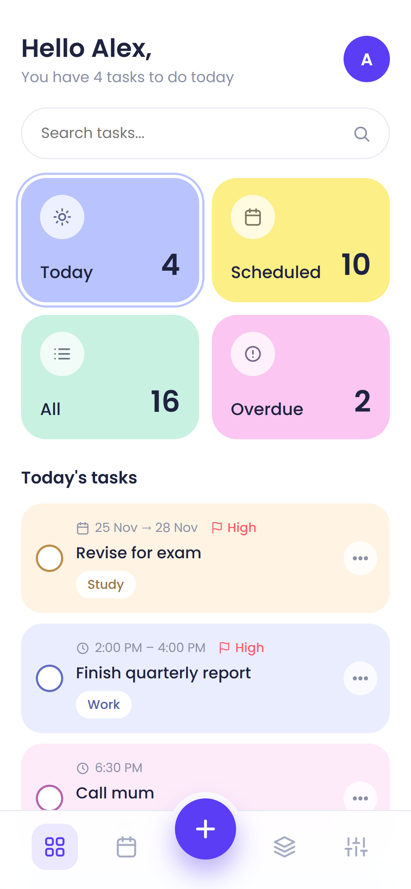

# Prioritise

A to-do app built with Django to plan tasks by priority, category and date.

## Features
- Sign up and log in
- Colour-coded categories
- High / Medium / Low priority
- Start and end dates, start and end times
- Repeat every day
- Today, Scheduled, All and Overdue views
- Month calendar
- Search tasks
- Works on desktop and mobile

## Screenshots
| Calendar | Mobile |
| --- | --- |
|  |  |

## Tech
Python, Django, SQLite, HTML, CSS, JavaScript

## Run locally
1. `python -m venv venv`
2. `venv\Scripts\activate`
3. `pip install -r requirements.txt`
4. `python manage.py migrate`
5. `python manage.py runserver`
6. Open http://127.0.0.1:8000
